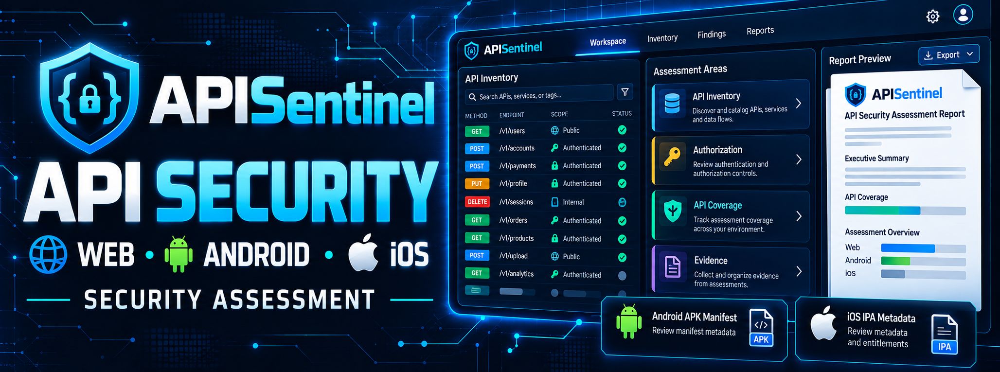
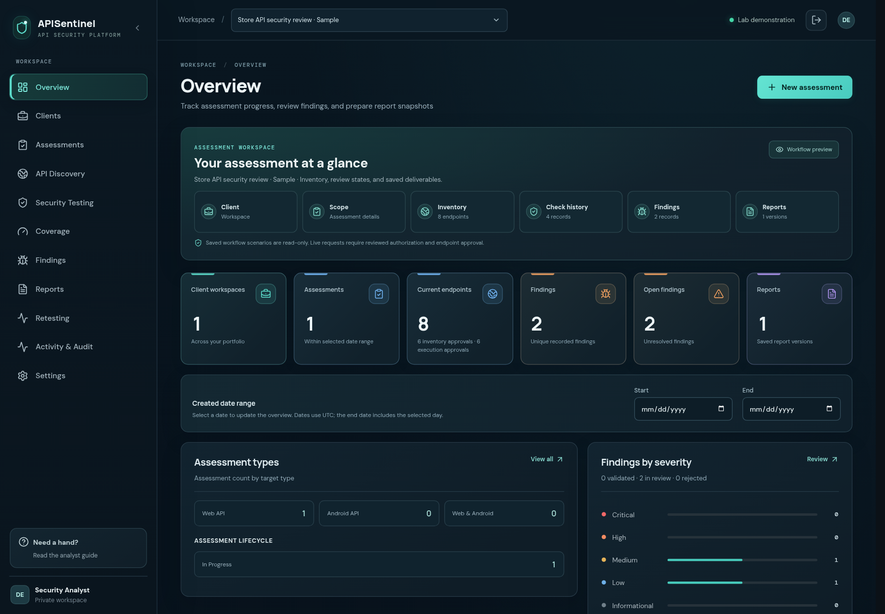
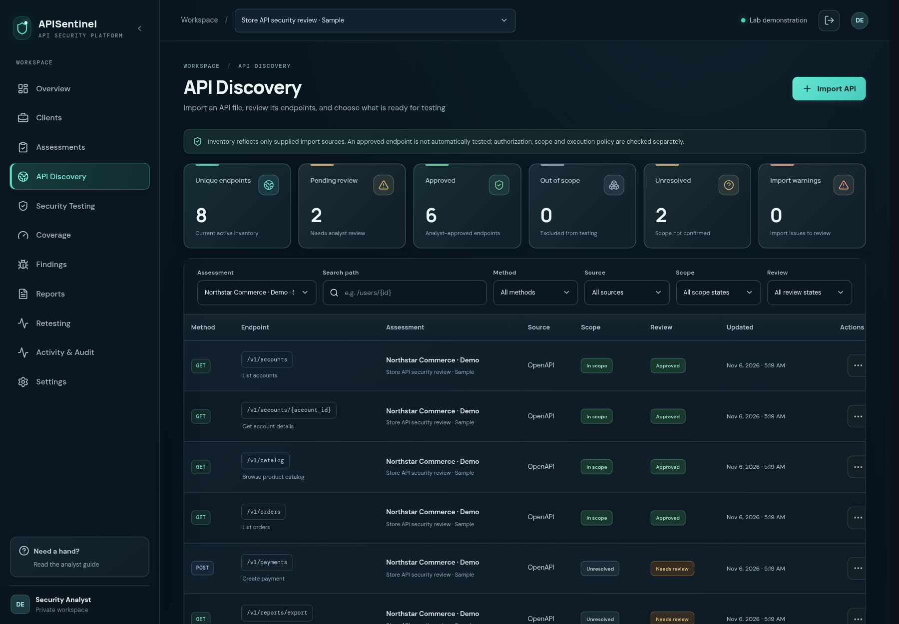
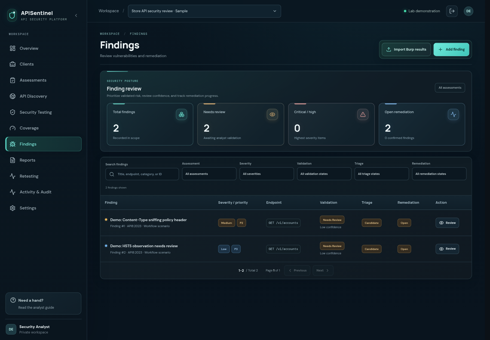
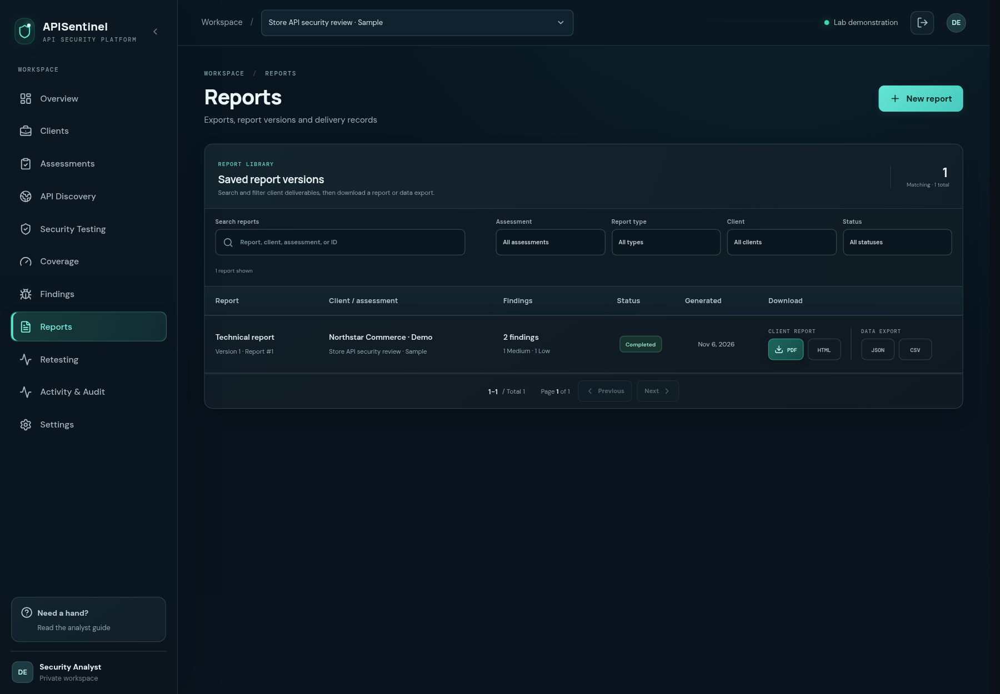
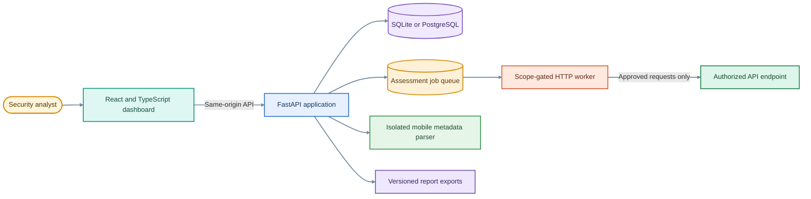

<a id="top"></a>

<h1 align="center">🛡️ APISentinel</h1>

<p align="center"><strong>An analyst-led workspace for authorized API security assessments</strong></p>

<p align="center">
  Scope & Authorization · API Inventory · Bounded Checks · Findings · Retesting · Reports
</p>

<p align="center">
  <a href="#quick-start"></a>
  <a href="#product-demo"></a>
  <a href="#safe-use"></a>
  <a href="https://github.com/sahadatx/APISentinel/actions/workflows/ci.yml"></a>
</p>

<p align="center">
  
</p>

<p align="center">
  
  
  
  
</p>

<hr>

<a id="overview"></a>

## 📖 Overview

APISentinel is a self-hostable workspace for organizing authorized API assessments. It brings client and assessment records, scope review, passive API inventory, limited read-only checks, analyst-reviewed findings, retesting, coverage records, and report snapshots into one application.

> **Project status:** APISentinel is an evolving assessment workspace, not a comprehensive vulnerability scanner or a client-ready penetration testing service. Its checks are deliberately narrow; review the scope and limitations below before using it.

## 📑 Contents

- [Overview](#overview)
- [Product demo](#product-demo)
- [Workspace preview](#workspace-preview)
- [Capabilities](#capabilities)
- Assessment design
  - [Architecture](#architecture)
  - [Assessment workflow](#assessment-workflow)
  - [Security checks](#security-check-catalog)
  - [Imports and mobile reviews](#supported-imports-and-reviews)
  - [Reports](#reports-and-exports)
- Setup and use
  - [Quick start](#quick-start)
  - [Usage](#usage)
  - [Docker](#docker)
  - [Configuration](#configuration)
  - [CLI commands](#cli-commands)
  - [API reference](#api-reference)
- Project
  - [Testing and CI](#testing-and-ci)
  - [Project structure](#project-structure)
  - [Safe use](#safe-use)
  - [Contributing](#contributing)
  - [Author](#author)

<a id="product-demo"></a>

## 🎥 Product Demo

Watch a 70-second walkthrough of the workspace using fictional lab records.

https://github.com/user-attachments/assets/5862fe3a-323a-420f-a0e1-43c13244927a

<a id="workspace-preview"></a>

## 📸 Workspace Preview

These fictional lab screens show the main assessment views; they contain no client data.

| Overview | API inventory |
|:---:|:---:|
|  |  |
| Findings review | Report delivery |
|  |  |

<a id="capabilities"></a>

## ✨ Capabilities

Manage client engagements, authorization and scope, passive endpoint imports, analyst-reviewed findings, retests, and versioned reports in one workspace.

- **API inventory:** Import supported API definitions and traffic metadata; requests are not replayed.
- **Controlled checks:** Ten narrow, read-only checks are registered; seven are enabled by default. Active checks require scope, authorization, endpoint approval, and operator gates.
- **Assessment records:** Track findings, evidence references, remediation, retests, coverage, and audit history.
- **Mobile metadata:** Review selected Android manifest and iOS `Info.plist` fields without executing application code.

Check coverage is partial and analyst-led; APISentinel is not a complete OWASP audit or general-purpose vulnerability scanner.

<a id="architecture"></a>

## 🏗️ Architecture

The React and TypeScript dashboard talks to a FastAPI service. The service stores assessment state in SQLite for local use or PostgreSQL for shared deployments. A database-backed worker processes explicitly queued work, while an isolated parser handles Android and iOS metadata.



> [!IMPORTANT]
> Active HTTP execution is disabled by default. The runner supports only bounded `GET`, `HEAD`, and `OPTIONS` requests, and requires current scope-bound authorization, an approved endpoint, and the explicit operator setting before sending traffic.

<a id="assessment-workflow"></a>

## 🔄 Assessment Workflow

APISentinel keeps assessment planning, authorization, discovery, checks, and analyst conclusions as separate records.

```mermaid
flowchart LR
  subgraph scopePhase["01 · SCOPE"]
    direction TB
    Client([Client and assessment]) --> Auth[Authorization and scope review]
  end
  subgraph inventoryPhase["02 · DISCOVER"]
    direction TB
    Import[Passive import] --> Inventory[Endpoint inventory review]
  end
  subgraph checkPhase["03 · CHECK"]
    direction TB
    Approve[Endpoint approval] --> Check[Bounded registered check]
  end
  subgraph deliveryPhase["04 · REVIEW AND DELIVER"]
    direction TB
    Triage[Analyst finding review] --> Retest[Remediation and retesting] --> Report[Versioned report snapshot]
  end

  Auth --> Import
  Inventory --> Approve
  Check --> Triage

  classDef scope fill:#E7F0FF,stroke:#3474C4,color:#18385F,stroke-width:2px,font-size:16px
  classDef discovery fill:#DFF7F3,stroke:#14967D,color:#124C43,stroke-width:2px,font-size:16px
  classDef execution fill:#FFF1D8,stroke:#D18700,color:#563A0B,stroke-width:2px,font-size:16px
  classDef delivery fill:#EEE8FF,stroke:#7656A8,color:#38265B,stroke-width:2px,font-size:16px
  class Client,Auth scope
  class Import,Inventory discovery
  class Approve,Check execution
  class Triage,Retest,Report delivery
  style scopePhase fill:#F6F9FF,stroke:#7BA4DB,stroke-width:2px,color:#18385F
  style inventoryPhase fill:#F2FCF9,stroke:#67B9A7,stroke-width:2px,color:#124C43
  style checkPhase fill:#FFFAF0,stroke:#E0AC4E,stroke-width:2px,color:#563A0B
  style deliveryPhase fill:#F8F5FF,stroke:#A48CD0,stroke-width:2px,color:#38265B
  linkStyle default stroke:#71869B,stroke-width:2px
```



> [!WARNING]
> Active requests are off by default. A current authorization, in-scope approved endpoint, compatible registered check, and the operator setting must all be present before the worker can send a request.

> [!NOTE]
> Imported traffic is used to build inventory and is never replayed during ingestion.

<a id="security-check-catalog"></a>

## 🧪 Security Checks

The registry has ten bounded checks for selected API security signals. The example configuration enables seven; `APISENTINEL_ENABLED_SECURITY_TESTS` controls the selection.

<details>
  <summary>Show the current check list and limits</summary>

| Check | Limit |
|:---|:---|
| CORS and session-cookie policy | One response; does not prove browser exposure. |
| Content-type sniffing and HSTS headers | Header observations only; no browser or certificate validation. |
| Verbose server errors | Inspects a bounded 5xx response prefix; does not retain response text. |
| Unauthenticated access | One unauthenticated read to a contract-marked protected endpoint. |
| Sensitive-looking JSON properties | Evaluates names only; discards values and paths. |
| Rate-limit metadata | One response; does not test quotas or burst limits. |
| BOLA synthetic-object comparison | Four bounded GETs; needs two test identities and known synthetic objects. |
| Function-role comparison | Two bounded GETs; needs a client-confirmed role expectation. |

</details>

Results are observations for analyst review, not proof that a vulnerability exists or is absent.

<a id="supported-imports-and-reviews"></a>

## 📦 Imports and Mobile Reviews

| Input | What APISentinel records | Boundary |
|:---|:---|:---|
| **OpenAPI 3.0 / 3.1 JSON** | Sanitized operation and endpoint inventory for analyst review. | Remote `$ref` documents are not fetched. |
| **Postman Collection v2.1 JSON** | Request method, URL, and inventory metadata. | Request values and bodies are discarded. |
| **Burp HTTP history JSON** | A bounded, documented structured subset of HTTP history. | Not a general Burp project or every Burp export format. |
| **Browser HAR / Android traffic capture** | Bounded HTTP metadata for endpoint inventory. | No request replay; sensitive values are discarded. |
| **GraphQL introspection JSON** | Sanitized schema and type metadata. | Offline import only; no GraphQL operation or security probe is sent. |
| **Burp Scanner issue XML** | Supported scanner issues as unvalidated finding candidates. | Importing issues does not reproduce or validate them. |
| **Android APK** | Selected manifest and package metadata through an isolated parser. | Upload limit is 20 MiB; code is not executed or dynamically tested. |
| **iOS IPA** | Selected `Info.plist` and package metadata through the isolated parser. | Upload limit is 50 MiB; no runtime or device testing. |

Imported endpoints start as inventory records. Review the source, scope, and exclusions, then explicitly approve an endpoint before selecting it for a check.

<a id="reports-and-exports"></a>

## 📄 Reports

Create a versioned snapshot for analyst review or delivery.

| Report type | Focus |
|:---|:---|
| **Technical** | Assessment scope, reviewed findings, evidence references, checks, coverage, and retest history. |
| **Executive summary** | High-level validated finding summary for non-technical readers. |
| **Remediation** | Finding remediation states and analyst guidance. |
| **Retest closure** | Retest outcomes and closure status. |

Exports: **PDF, HTML, JSON, and CSV**. Creation and export are recorded in the audit history.

<a id="quick-start"></a>

## 🚀 Quick Start

Requires Python 3.11+, Node.js 22+, and npm. Clone the repository, then run:

```bash
git clone https://github.com/sahadatx/APISentinel.git
cd APISentinel
python -m venv .venv
source .venv/bin/activate
python -m pip install -e '.[dev]'
npm --prefix dashboard ci
cp .env.example .env
alembic upgrade head
apisentinel create-user analyst@example.test
npm --prefix dashboard run dev
```

The account command prompts for a password. The dashboard launcher starts the local API and queue worker; open <http://127.0.0.1:5174>. Interactive API docs are at <http://127.0.0.1:8001/docs>.

Keep `.env` private. Configure a credential-encryption key through a protected environment before enabling encrypted credentials or TOTP enrollment. The development launcher uses Bash; Windows users can use WSL or Docker.

<a id="usage"></a>

## 🧭 Usage

Typical flow: create the client and assessment → record authorization and scope → import API material → review and approve endpoints → run an eligible check → triage, retest, and export a report.

<a id="docker"></a>

## 🐳 Docker

Docker Compose starts the API, worker, dashboard, and isolated Android APK parser:

```bash
docker compose up --build --detach
docker compose exec api apisentinel create-user analyst@example.test
```

Open the dashboard at <http://127.0.0.1:5173> and API documentation at <http://127.0.0.1:8000/docs>. The compose configuration binds published ports to loopback and keeps the APK parser on an internal network.

<a id="configuration"></a>

## ⚙️ Configuration

Configuration is read from `APISENTINEL_*` variables. See [`.env.example`](.env.example) for the complete list. Key controls:

| Variable | Purpose and default |
|:---|:---|
| `APISENTINEL_DATABASE_URL` | SQLite locally; PostgreSQL for shared deployments. |
| `APISENTINEL_ALLOW_ACTIVE_TESTS` | Active-request operator gate; defaults to `false`. |
| `APISENTINEL_ENABLED_SECURITY_TESTS` | Enabled check IDs from the registry. |
| `APISENTINEL_RUNNER_EGRESS_ALLOWED_CIDRS` | Runner destination allowlist for staging and production. |
| `APISENTINEL_CREDENTIAL_ENCRYPTION_PROVIDER` | Local Fernet or AWS KMS. Keep keys in a secret store. |

Production also needs HTTPS, a private parser service, and network egress controls; application CIDR checks do not replace firewall rules.

<a id="cli-commands"></a>

## ⌨️ CLI Commands

Use `apisentinel --help` for the full command list.

| Command | Purpose |
|:---|:---|
| `apisentinel create-user analyst@example.test` | Create an analyst account. |
| `apisentinel serve` | Start the API service. |
| `apisentinel worker` | Start the job worker. |
| `apisentinel backup-database --help` | Show SQLite backup options. |

Database backup and restore helpers support SQLite; use PostgreSQL's native tools for PostgreSQL.

<a id="api-reference"></a>

## 🔌 API Reference

The API is versioned under `/api/v1`. Open the interactive [OpenAPI docs](http://127.0.0.1:8001/docs) locally or `/docs` in Docker; the JSON schema is at `/openapi.json`.

<a id="testing-and-ci"></a>

## 🧪 Testing and CI

Run the main checks locally:

```bash
pytest -q
ruff check src migrations tests
npm --prefix dashboard run build
```

GitHub Actions is configured to run backend tests, lint and compilation, SQLite and PostgreSQL migrations, PostgreSQL recovery checks, and a dashboard build on pushes and pull requests. Check the [Actions page](https://github.com/sahadatx/APISentinel/actions) for the latest run result.

<a id="project-structure"></a>

## 📁 Project Structure

```text
APISentinel/
├── src/apisentinel/           FastAPI app and services
├── dashboard/                 React and TypeScript UI
├── apk_parser/                Isolated mobile metadata parser
├── migrations/                Alembic migrations
├── tests/                     Backend and browser tests
├── images/                    Banner, preview, and demo video
└── docker-compose.yml         Local multi-service setup
```

<a id="safe-use"></a>

## 🛡️ Safe Use

> **Authorized testing only.** Use local fixtures or explicitly authorized lab/staging targets. Before any real assessment, confirm the written authorization, exact scope, allowed methods, testing window, request ceiling, and stop conditions.

- Active requests are disabled by default and require current authorization, an approved in-scope endpoint, a compatible check, and operator enablement.
- Checks are limited to bounded read-only observations. APISentinel does not provide fuzzing, broad crawling, write testing, load testing, or mobile dynamic analysis.
- Results require analyst review; APISentinel does not verify the legal authenticity of authorization records and is not a comprehensive penetration testing service.

<a id="contributing"></a>

## 🤝 Contributing

Issues and focused pull requests are welcome. For a substantial change, open an issue first; include the user-visible behavior, security boundary, migration impact, and documentation updates in the pull request. Never use real client credentials, target data, or evidence in sample fixtures.

Before opening a pull request, run the backend tests, Ruff checks, and dashboard build listed in [Testing and CI](#testing-and-ci). Add or update focused regression tests for behavior changes.

<a id="author"></a>

## Author

**Sahadat Hossain**

Cybersecurity Researcher • Penetration Tester • Python Developer

### Contact

- 📧 **Email:** [pentester.sahadathossain@gmail.com](mailto:pentester.sahadathossain@gmail.com)
- 💼 **LinkedIn:** [linkedin.com/in/pentester-sahadat-hossain](https://www.linkedin.com/in/pentester-sahadat-hossain/)
- 🐙 **GitHub:** [github.com/sahadatx](https://github.com/sahadatx)
- 🌐 **Portfolio:** [sahadatx.github.io/Personal-Portfolio](https://sahadatx.github.io/Personal-Portfolio/)

> Feel free to connect for collaboration, security research, or open-source contributions.

---

If you found this project useful, consider supporting it by:

- ⭐ Starring the repository
- 🍴 Forking the project
- 🤝 Contributing improvements
- 📢 Sharing it with others

---

<p align="center">
Made with ❤️ by <strong>Sahadat Hossain</strong>
</p>

<p align="right">
<a href="#-overview">⬆️ Back to Top</a>
</p>
